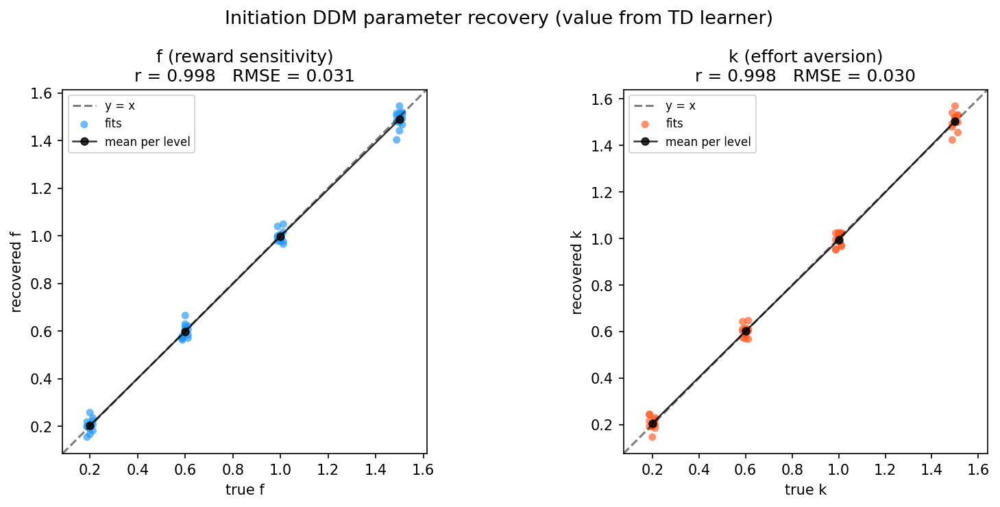

# Modeling motivation through ordinary task behavior

A computational model of task initiation. From choices, reaction times and how long
someone works on a question before giving up, it recovers how strongly a person is
pulled by reward, how strongly they are pushed away by effort, and how quickly they
give up on a question. How they react to the set they just played needs no parameter
of its own: it reaches the decision as prediction error, scaled by the reward
sensitivity.

The goal is to use these parameters to reshape the environment (how hard the
questions are for this person, how often mistakes come back, whether right/wrong
is shown, whether questions they gave up on come back) so that engaging becomes
easier than stopping.

This is an active research project. It runs on simulated people, and on human
sessions played in the app (`temporal/app/`) that are recorded across sessions. No estimate
from a real person has been validated yet.

---

## Contents

- [Running the app](#running-the-app)
- [Main equation](#main-equation)
- [Model structure](#model-structure)
- [The controller (controller.py)](#the-controller-controllerpy)
- [Human sessions (temporal/app/)](#human-sessions-temporalapp)
- [Current results](#current-results)
- [Methodological notes](#methodological-notes)
- [Known limitations](#known-limitations)
- [Next steps](#next-steps)
- [Reproducing every result](#reproducing-every-result)
- [Files](#files)
- [Value bootstrap: continuing since 2026-09-13](#value-bootstrap-continuing-since-2026-09-13)
- [Code layout, tests and speed: since 2026-10-11](#code-layout-tests-and-speed-since-2026-10-11)

---

## Running the app

```bash
uv sync
```

Run every command from the repo root. `uv run` uses the project's environment; inside an
activated `.venv`, plain `python` works too.

```bash
uv run python -m temporal.app.desktop                                 # in a window; data in data/
TEMPORAL_RESEARCHERS=you@example.com uv run python -m temporal.app.web # in a browser at http://127.0.0.1:8000
TEMPORAL_PANEL=1 uv run python -m temporal.app.web                    # as a guest, with the dev panel
```

The web app keeps only researchers' records until `TEMPORAL_COLLECT=1`; see "On a website".
With the dev panel open, "show the accumulator next to the task" draws the model's live
prediction beside each start and redo decision.

---

## Main equation

Every time a person finishes a set, they face a small decision: start the next
one, or stop. The model formalizes that decision as

```
Drive = f · Value − k · EffortCost
Value = V(0) + Σ δ                  Σ δ: the last set's prediction error, carried
```

- `f` is reward sensitivity: how strongly the expected payoff pulls the learner in.
- `Value` is what the learner believes the next set is worth, `V(0)`, plus how the
  set just played came out against what was predicted of it.
- `k` is effort aversion: how strongly cost pushes the learner away.
- `EffortCost` is how much it takes to get going again.

The drift has only these two parameters. What the last set did to this person has no
term of its own. It is prediction error, which reaches the accumulator through `Value`
and is scaled by the same `f` as everything else. When you see that you got a question
wrong, that slot paid nothing against a value that expected something, which is a
negative `δ`. A miss you are not shown cannot produce one. "Feedback is timing, not
reward" (under "The learner") covers what this gains and what it gives up.

Drive does not produce a decision instantly. It feeds a noisy accumulator (a drift
diffusion model) that races toward one of two boundaries, GO (start the next set)
or STAY (stop), and yields both a choice and a reaction time. The reaction time is
what makes the parameters separable: choices alone cannot distinguish a high `f`
from a low `k`, but the shape of the RT distribution can.

### Giving up on a question

A person can skip a question, but only after trying it; there is no separate
"answer it or skip it" choice. While they work, the same drive runs the other way:

```
quit drift = k · cost − f · value
value = ACHIEVEMENT_SCALE · p(1 − p) / stage_amt + δ  what getting it right would add,
                                                      plus the error at the slot just left
cost  = REPEAT_COST_SCALE · min(1/p, 8)               the effort it takes
```

with `p` their chance on that question. It feeds a one-boundary accumulator (same
`SIGMA` and `BOUND`); if it reaches the bound before they reach an answer, they give
up. The time to give up then has a closed form, the inverse Gaussian (Wald)
distribution (`model/persistence.py`). Giving up is a skip, or leaving if they close the app
on that question.

- **Patience is per person.** Model time becomes seconds through `patience`, the
  seconds per unit of model time; someone who skips at a glance has a small one. It
  was a fixed 10 s at first, which makes skips of a few seconds all but impossible.
- **Answered questions count too.** An answer after 25 s says "kept going at least
  25 s", so it enters the likelihood through the survival function, as a right-censored
  time to give up. Every question is an observation, skipped or not.
- **2% of questions are lapses**: given up on, or kept at, for reasons the model does
  not describe, at a uniform time within 60 s. One odd skip, such as dropping an easy
  question after two seconds, then cannot decide the estimate on its own.
- **Leaving from the first question after coming back** is giving up on it too. In
  the simulator, giving up on the first question of a set started cold abandons the
  set, and the person is away again.
- **A skip is neither right nor wrong**, so it does not move the ratings.
- **The last question carries into this one.** `δ` is the prediction error from the
  slot just left: seeing that you missed the last one makes giving up on this one more
  likely, and seeing that you got a hard one right makes it less. With feedback hidden
  there is no error to carry, so `δ` is 0 and only `p` matters.
- **It is used for patience only.** `f` and `k` come from decisions; answer and skip
  times add nothing to them (see "Skips do not help estimate `f` and `k`" under
  Current results).

---

## Model structure

Four layers: an environment, a learner, decision nodes, and an inference step that
inverts all three.

### 1. Environment

A staged task. Each set is `stage_amt` slots (default 4), one question in each.

**Question types, rated per person** (`model/questions.py`). Questions come in types, each
with a rough prior difficulty in logits:

| type | example | prior |
|---|---|---|
| add, 1-digit | 7 + 5 | −2.0 |
| add, 2-digit | 47 + 38 | −0.5 |
| subtract, 2-digit | 83 − 47 | 0.0 |
| times tables | 8 × 7 | 0.0 |
| multiply, 2-digit × 1-digit | 64 × 7 | 1.0 |
| subtract, 3-digit | 702 − 358 | 1.0 |
| divide, 3-digit ÷ 1-digit | 952 ÷ 7 | 2.0 |
| multiply, 2-digit × 2-digit | 47 × 38 | 2.5 |
| multiply, 3-digit × 2-digit | 347 × 58 | 3.5 |

The prior is only a starting guess. After every answer an Elo-style update re-rates
both the person and that type,

```
p = sigmoid(ability − difficulty[type])
ability         += K_a · (correct − p)
difficulty[type] −= K_d · (correct − p)        steps shrink as answers accumulate
```

so a type's rating ends up describing how hard it is *for this person*. Each slot
then serves a type whose predicted chance is nearest the current **target chance**
(types within 0.1 of the best match are all eligible, so near-equivalent types all
get rated). Hard is relative to the person by construction.

**Only a question's first showing rates it.** A review or redo of the same question is
not a fresh sample of its type. Without this rule, one question shown many times could
be all the evidence behind a person's chance on its whole type.

**Typos are not misses** (interface). A miss put right on the redo within 2 s
(`SLIP_SECONDS`) is treated as a slip: the ratings are restored to before the miss and
the question is rated as answered right, it is not owed, and it does not count as a
miss. A wrong answer fixed in under a second is a slip of the keyboard, not a gap in
skill.

The recovery pipelines (`python -m temporal recovery`) still use the older single-`diff`
task (with optional per-stage `diff_spread`); question types are used by `controller.py`'s
simulated people and by the app.

**What a set is worth.** A set's reward is its right answers, each weighted by how
hard it was, times a scale (when each part of it lands is under "The learner"):

```
reward = ACHIEVEMENT_SCALE · Σ_right (1 − p) / stage_amt        ACHIEVEMENT_SCALE = 4
```

A trivial right answer earns almost nothing, so a set of easy wins is worth little
and a learner can stop out of boredom. Under the previous reward (fraction right)
the model could not represent that: it believed the easiest setting was always the
most rewarding, so a person served only single-digit questions was never offered
anything harder (the V1 comparison is in `RETIRED.md`).

The scale is a calibration. The expected reward per question,
`p(1 − p)`, peaks at 0.25; scale 4 makes that peak 1.0, the value of a perfect set
under the old reward, so `f` keeps its earlier meaning. Since drive
is `f · Value`, the scale and `f` are interchangeable: changing one is equivalent to
rescaling the other.

The effort a set costs is its review load (the share of slots spent
going back over mistakes), and it raises the cost of the next start decision.

A slot normally holds a new question. It can instead revisit one missed
earlier, displacing the new question: sets never get longer, so review trades
against coverage. Who decides that is `review_mode`, described under the learner.

When right/wrong is hidden for a set, there is also no redo prompt: it
would only ever appear after a miss, so offering it would reveal the miss. Owed
questions still come back through review.

A skipped question spends its slot and earns nothing. It is held apart
from the questions missed: whether skipped questions join what review brings back is
a setting (`return_skipped`, a controller lever). One that comes back and is answered
right counts as a correction; answered wrong, it is owed like any miss; skipped
again, it stays skipped.

**Questions that come back** (interface). A question is never shown twice in one set,
except as a redo the person chose. One that comes back and is missed or skipped 3 times
(`RETIRE_AFTER`; redos do not count) is retired: it stops coming back, and a `retired`
event is logged. Without it, a question someone keeps skipping can come back again and
again. The simulator's owed items are question types rather than individual questions,
so neither rule applies there.

When the learner is the one deciding redos (`review_mode = "choice"`), effort
aversion produces a spiral nothing stipulates: high `k` declines the redos, so less
is learned, so fewer questions are answered right, so `V` stays low, so
re-engagement drops. It was measured under V1 (`RETIRED.md`) and has not been
re-measured.

### 2. The learner

The learner maintains two quantities, kept separate by design.

Value, learned by TD(0) with linear function approximation:

```
V(s) = θ · φ(s)                    φ(s) = [1, stage position]
δ    = r + γ·V(s+1) − V(s)         θ ← θ + α·δ·φ(s)
```

At a set's last slot, `V(s+1)` is `V(0)`, the start of the next set: the continuing
bootstrap (see "Value bootstrap").

**A slot's reward arrives when the person is shown it.** With feedback on, a question's
worth lands at that slot: `ACHIEVEMENT_SCALE · (1 − p) / stage_amt` if they got it
right, nothing if they did not.
With feedback off nothing lands until the end-of-set score, which pays the whole set at
once. A set totals the same either way: feedback moves *when* the signal arrives, not
how much (`value.slot_reward`). That timing is the whole of feedback's effect on
motivation, and it is what the three reaction terms used to stand in for (see below).

With feedback hidden this is exactly the old schedule, one lump of
`ACHIEVEMENT_SCALE · achievement / stage_amt` at the last slot, so the only change is
that showing an outcome moves its reward forward to the slot it happened at.

#### Feedback is timing, not reward (since 2026-09-21)

Until 2026-09-21 the drift had three more terms,
`b_seen · seen_miss + b_unseen · unseen_miss + b_fb · feedback`. They patched a hole in
the learner: mid-set outcomes produced no prediction error at all, because every slot but
the last paid zero reward, so a miss the person was shown moved `δ` by nothing and
feedback never entered the TD system. The terms read, off to the side, what the value
system should have been computing.

They were replaced by the mechanism they stood in for. A slot's worth lands when the
person is shown it; with feedback hidden it lands at the end-of-set score, and a set
totals the same either way. A seen miss is then a slot that paid nothing against a value
that expected something, a negative `δ`, and an unseen miss cannot produce one. That
error is carried into the next decision through `value`, at full weight, scaled by the
same `f` as everything else. Three fitted parameters went and none came in.

- **Whether to show feedback is derived, not fitted.** Showing an outcome delivers its
  `(1 − p)` early, discounted less, and also delivers the misses instead of burying them
  in the end-of-set lump, so its effect depends on difficulty. What that does to reward
  is measured under "Which difficulty and whether to show feedback".
- **Boredom is a state the model can express**: sustained `|δ| ≈ 0`. A trained person on
  an easy question has `(1 − p) → 0`, so being shown they were right confirms an
  expectation and pays nothing.
- **What it gives up** is a person *spurred on* by a visible miss. `b_seen > 0` was the
  only way to express that sign; under pure RPE a seen miss is negative for everyone, in
  proportion to their `f` (see "Known limitations").

The reaction terms' recovery and the controller results that depended on them are in
`RETIRED.md` (V1, V2).

`φ` used to carry `difficulty` as a second feature. It was doing no work: `diff`
never varies during learning, so `θ[1]` collapsed to exactly `θ[0]·d`, perfectly
collinear with the intercept, and contributed ~1% of `V(0)`.

Competence, in the simulator, is learned only from correcting what was missed:

```
P(success) = sigmoid(ability − difficulty)       ← Rasch / IRT
outcome    ~ Bernoulli(P(success))               ← per question
ability   += CORRECTION_GAIN   only when a question answered wrong (or skipped)
                               earlier is shown again and answered right
```

A first-time correct answer teaches nothing, and neither does a failure; only a correction
does (`competence.update_ability`, `competence.settle_skipped`). This is deliberate
practice rather than error correction: working a question out between sessions, without
being shown it again, teaches nothing here.

**Measured versus simulated competence.** For a real person there is nothing to
simulate: the app *measures* competence with the Elo ratings above, and the
controller's rollouts start from that measurement. The corrected-question rule is
how a simulated person's true ability changes; the ratings are what the environment
can know about it. The controller only ever sees the ratings, never a simulated
person's truth.

**Who decides whether a missed question comes back** is `review_mode` on
`Simulation`, not the learner in general:

| mode | who decides | learning gated by |
|---|---|---|
| `scheduled` (default) | the controller, at `review_rate` per slot | the schedule |
| `choice` | the learner, offered a redo after each miss | `k` |
| `quiet` | nobody; missed questions never return | nothing is learned |

That choice is what keeps `k` a motivational parameter. When the learner decides,
`k` sets the learning rate as well as the willingness to start, and effort cost and
skill can no longer be manipulated separately (V1 measurement in `RETIRED.md`).

Competence is kept off `δ` because these are different learning systems. Prediction
error is the teaching signal for value; competence comes from repetition and error
correction, a largely separate learning system. Driving skill from `max(0, δ)`
would halt competence growth as soon as predictions become accurate, which is the
wrong direction: expertise continues to refine long after outcomes become
predictable.

### 3. Decision nodes

The two choices, starting the next set and redoing a miss, use the **same
accumulator** (same drift form, noise, bound and deadline) fed different conditions.
They are two observations of the same person, and their draws stack into one fit.
`GO = 1` means "took the effortful option" in both.

**The initiation node** sits between sets and decides whether to start the next one.

- Value is `V(state, 0)` plus the last set's total prediction error, `Σ δ`, clipped to
  `±DELTA_CLIP` so the condition grid stays bounded. The error is carried at full
  weight; there is no fitted carry coefficient.
- EffortCost is `structural(in_session) + EFFORT_WEIGHT · last_episode_effort`:
  `WARM_COST` (0.05) while in a session, `state.reentry_cost` (the cold-start
  profile: `low` 0.3, `mid` 0.6, `high` 1.0) after leaving, plus `EFFORT_WEIGHT` (0.1)
  times `1 + review load` of the last set. Every recorded start decision is in a session,
  so the cold-start cost only sets how long a person stays away (below).
- The noise is fixed at `SIGMA = 0.7`. It sets the unit everything else is measured in,
  as in the standard DDM, and it cannot be fitted together with the bound: scaling drift,
  bound and noise by one factor changes nothing observable. The bound is `BOUND = 1.5`
  in every fit except where it is fitted per person ("Fitting the discount factor" and
  "The bound can be fitted"). The deadline `T_DUR = 7.0` is a cutoff of the analysis, not
  a property of the person, so it is never fitted: a person who decides slowly is
  described by their bound and non-decision time. It was 3.0 s until 2026-09-13; see
  "The deadline must sit past human decision times".

**The repeat-or-continue node** fires after a missed new question, when the learner
decides redos and feedback is shown. It fires *after* the miss has landed as reward,
not before: they see how the question went, that produces the error, and then they
decide whether to take it again. Value is the slot's share of the terminal reward,
discounted by slots to come, plus that error, so missing an easy question, which is
the bigger surprise, discourages the redo more than missing a hard one. Cost is how
hard the missed question is for them: `REPEAT_COST_SCALE` (0.15) times the expected
attempts `1/P(success)`, capped at 8. Cost varies more here than anywhere else, so what
this node carries is `k`.

**The persistence node** runs on every question while it is being worked on (see
"Giving up on a question"). It shares `f` and `k` with the other two but is a
one-boundary process with no deadline. Seconds become model time through the person's
`patience` (default 10 s), estimated per person. Simulated people also need a time
to solve each question; it is lognormal with a median of `4 s / p^0.7`: about 4 s for
a sure thing and 20 s at a 10% chance. Real people simply take the time they take.

**Sessions, and what is recorded (since 2026-10-25).** The simulated person follows the
app's rules, so the simulator records only what the app could:

- **One stop ends the session.** "I'm done" closes the app, so a session holds at most
  one stop. After it the person is away: each tick is a chance to come back, decided by
  the same accumulator at the cold-start cost, and none of it is recorded. Not opening
  the app leaves no trace, and opening it is a decision whose "RT" is hours. Coming back
  starts a set cold, and the next recorded start decision is the warm one after it.
- **A slow choice is still made.** A draw that reaches no bound by `T_DUR` is recorded
  as undecided, which is how the fit reads a slow human click. The person then carries
  on deliberating: they end up at the bound the same diffusion reaches after the deadline
  (`accumulator._upper_after_deadline`, exact for constant drift), and that is what they
  do. The same holds at the redo prompt.

Before V4 the simulator recorded every start draw: up to three stops in a row inside a
session, then every cold start until the next GO. Those rows carried most of the start
node's cost variation, and no person can produce them. Every earlier simulated result
was measured that way; they are in `RETIRED.md` with an account of the flaw ("The
recording flaw in V1 to V3"). `tests/test_sessions.py` checks that no two recorded
start decisions have no set between them, and that none is cold.

### 4. Inference

PyDDM's `Model.fit()` solves the Fokker-Planck equation for the first-passage time
distribution and fits by differential evolution: `(f, k)`, bounded to `[0, 3]`. Those two
are the whole drift. Where real people are fitted (the controller's estimate and the
interface's fit), the non-decision time `T0` is fitted as well, bounded to [0, 0.5] s;
the recovery pipelines pin it at 0 (see "Recovery demonstrates identifiability, not
accuracy"). What the last set did to the person is already inside `value`, so it needs
no parameters of its own and is not fitted separately.

Answer and skip times have a closed-form likelihood (`persistence.neg_log_likelihood`,
per second, with lapses). The controller uses it only for patience
(`persistence.fit_patience`, with `f` and `k` held at the decisions' estimate). Passing
it to `fit` as `attempts` adds it to pyddm's likelihood through a custom loss, fitting
decisions and persistence as one set of parameters. That joint fit is kept for
comparison and is not used for planning.

A decision that reached no boundary by `T_DUR` is an undecided trial. That includes
a *person* who took longer than 7 s to click, since pyddm refuses outright to fit an
RT past the model's deadline. Undecided trials are fed back in as counts, not
discarded; see "Censored trials are data". How well the fit recovers `f` and `k` is
under "Current results".

**Fitting γ (since 2026-10-28).** γ is not in the drift; it shapes `value` through
learning. To fit it, the person's reward history is replayed through TD learners at
candidate values of γ (at the fit's α, 0.05), which gives the value every recorded
decision would have had under each. The γ whose values best explain the decisions is the
estimate: a profile likelihood, `(f, k)` fitted at each candidate. The app records
everything the replay needs. In simulation the replay runs alongside the person, as
shadow learners (`experiments/gamma_profile.py`, `GridShadow`).

**A closed-form likelihood (since 2026-10-28, `temporal/fastlik.py`).** With a constant
drift the accumulator's first-passage density has a standard series (Navarro & Fuss,
2009), and the chance of reaching neither bound by `T_DUR` has one too. `fastlik` adds
pyddm's `T0` shift and its uniform lapse mixture the same way pyddm does, and
`tests/test_fastlik.py` checks it against pyddm's Fokker-Planck solution: densities agree
within 0.2% of their peak and undecided probabilities within 0.001, at bounds 1.0 to 2.4,
`T0` 0 to 0.23 s and drifts −2.5 to 3. One evaluation takes about 0.2 ms at 700 decisions,
against seconds for a pyddm fit, and value needs no rounding to 0.05, so the likelihood
is smooth in γ. `experiments/recovery_lhc.py` uses it to fit `f`, `k`, γ, `BOUND` and `T0`
together, with standard errors from the observed and the Fisher information.

**What the app fits today.** The controller's estimate and the interface's "fit my
parameters" still fit `(f, k, T0)` with pyddm, γ held at 0.9 and `BOUND` at 1.5, and
`InfoController` plans with those values. Fitting γ and the bound there is not built
(see "Next steps").

---

## The controller (`controller.py`)

This is what the project is for: using the recovered parameters to adjust the
environment so the person keeps engaging and keeps being challenged.

The controller plans every 5 start decisions in the app (every 25 in the simulations under
"Current results"). When at least 15 new decided rows have come in since its last fit, it
re-fits the person's `f` and `k` (shrunk toward a prior while data is thin) and their
patience from time on questions. It then copies the person exactly as they are (measured
ability, how hard each question type is for them, what they still owe, their current
value) and simulates 96 candidate settings forward with the *estimated* parameters:

- a **target chance of getting a question right**, 90% down to 20%;
- a **review rate**: how an unanswered question comes back;
- **feedback shown or hidden**;
- **whether questions they skipped come back** through review, or are dropped. With
  review at 0 nothing comes back;
- **redo prompts**: after each miss they see, ask whether to take it again (the app's
  "offer repeat-or-continue"). These 12 settings (6 targets × feedback) have review 0, so
  a miss comes back only when the person chooses it.

Until 2026-10-11 there were 84 settings, all with scheduled review, and the rollouts
always scheduled review even though the app asks redos. The planner was simulating a
task the person never saw. Rollouts now follow the setting's review mode.

Rollouts include giving up on questions, driven by the same estimated `f` and `k` and
the person's estimated patience, so a hard target is worth less for someone who would
skip most of it.

There are two controllers. `Controller`, described here, plans for reward.
`InfoController` (see "Planning to measure") plans to measure `f` and `k`, and is the one
the app runs.

Rollouts count ticks, not decisions, so the time a person would spend away after
stopping earns nothing in them.

It screens all candidates with short rollouts (4 × 80 ticks), re-tests the best four and
the current setting with long rollouts on fresh seeds (16 × 300), and switches to the
one earning the most **total reward** only if that re-test beats the current setting
by more than twice its standard error. Short rollouts alone were too noisy to act on
(the V1 case that showed it is in `RETIRED.md`). The interface plans in a separate
process, so play continues meanwhile; one `InfoController` plan takes about 0.9 s (see
"Code layout, tests and speed").

About 15% of updates pick a setting at random instead. Those probes are independent of
the person, and when the best setting keeps feedback on they are the only source of
sets with it hidden, so they are what gets both ways of timing a set's reward into
the same record. `InfoController` makes no random probes: it varies the setting because
that is what it plans for.

The reward controller maximizes **total reward**: right answers weighted by how hard each
was for the person, `1 − p`, summed over the sets they go on to play. It is engagement
weighted by challenge, not engagement itself. Under V1, sets played was rejected as the
objective because it always favored the easiest setting (`RETIRED.md`). That reason no
longer holds: under the current model the easiest target is among the worst for engagement
(see "Which difficulty and whether to show feedback"). Whether the reward controller
should maximize engagement instead is open (Next steps). `InfoController`, which the app
runs, plans to measure `f` and `k`; its only engagement rule is the safety floor, which
counts sets started.

Two settings are not levers. `reentry_cost` is left out because cheaper re-entry always
wins, and since V4 it enters no recorded decision: it only sets how long a person stays
away, so it says nothing about `f` or `k` either. (Under V1, setting it from the person's
state coupled the recorded cost to value and collapsed the `k` estimate to zero.) Showing
the stage count or the score is left out because nothing in the model represents them.

### Planning to measure (`InfoController`, since 2026-10-11)

A controller that plans for reward settles on one setting, and once it does, cost stops
varying and `k` stops being identified. `InfoController` instead picks the setting
whose rollouts would most sharpen the `(f, k)` estimate.

Drift is `f · value − k · cost`, so a decision depends on `(f, k)` only through its
drift `μ`, and its Fisher information about `(f, k)` is
`I_μ(μ) · [[v², −vc], [−vc, c²]]`. `I_μ` covers choice, RT and undecided past the
deadline, and is computed once from pyddm solutions on a grid of `μ`. A setting scores
the rise in `log det(prior + data so far + its rollouts)`, which favours settings that
move value and cost in directions the data has not covered yet.

- **It plans for every person the data still allows, not one.** The score is averaged
  over 6 `(f, k)` draws: from the prior (`PRIOR`, sd 0.5) until the fit is used, then
  from a Laplace approximation, `N(estimate, (prior + data information)⁻¹)`. Each draw
  is rolled out with its own parameters (25 ticks per rollout). Planning for
  the single current estimate collected the best data for the wrong person early on.
- **Safety floor.** A setting is eligible only if its rollouts start at least half as
  many sets as the best setting's, so measuring cannot drive the person away.

---

## Human sessions (`temporal/app/`)

You answer the questions, choose whether to redo one you got wrong, and choose
whether to start the next set. There is no countdown: both prompts wait for you, and
the time to click is the reaction time. **"I'm done" closes the app** and is logged
as the stop decision. Closing the window without choosing is logged as an abandon.

**Skip** (the button under the answer box, or Esc) gives up on the question on
screen. It is logged with how long you worked on it and your predicted chance on it,
and the set moves on to the next slot. Whether skipped questions come back is the
"skipped questions come back too" checkbox, or the controller's call.

**Leaving is recorded with what was on screen.** Closing the window, Ctrl-C in the
terminal, closing the terminal, or `kill` all log an `abandon` with the screen you were
on. On a question it also records the question, your chance on it, how long you had
it, and whether it was the first question since opening the app. Looking at a question
and leaving is giving up on it, so it joins the persistence data. An exit nothing sees
(a crash, power loss) is found on the next launch and logged as `unlogged`, with the
question that was on screen and no time.

**Old saves are brought up to the current rules.** The first-showing, typo and
retirement rules apply to the whole record, not only to new answers. A state saved
under older rules gets its ratings and failed-return counts rebuilt from
`decisions.jsonl` on the next launch, logged as `rebuilt`, and questions that have
already failed 3 returns are retired. The record itself is never rewritten.

Replaying a record written under the current rules reproduces the ratings kept live
exactly, so the rebuild is the same rule applied after the fact, not an approximation.

`RULES` went to 3 on 2026-09-21, when the reaction terms were removed. That one is not
replayable: a start decision logged under rules 1 and 2 holds a `value` that predates the
prediction-error carry, so its `value` is right for the drift it was drawn under and
not comparable with a later row. The rows are kept and still fit, since the drift form
`f · value − k · cost` is unchanged, but they under-represent how much value varies.

**Everything persists** in `data/` (gitignored):

- `decisions.jsonl`: the record, append-only and synced to disk before the app moves
  on: every start and redo decision, every answer and skip (question, type, your
  answer, your predicted chance, time on it), exits with what was on screen, retired
  questions, set starts and ends, controller decisions, launches.
- `state.json`: the snapshot to pick up from: value weights, ratings, owed and skipped
  questions with their exact text, how often each came back and failed, settings, and what
  is on screen right now. Written atomically, so a crash never leaves half a file.
- `controller.pkl`: the controller, including its estimates.

Reopening the app logs a `return` with the time since you left, and every fit and
plan uses every session. "Export all decisions to csv" writes `data/decisions.csv`.

Tick **"controller sets target, review, feedback, skipped, redo prompts"** and
`InfoController` plans in a separate process every 5 start decisions and moves the
settings panel itself, with a line saying why. With it off, the target chance, review
rate, and the feedback, skipped and redo-prompt checkboxes are yours. Feedback changes
apply from the next set.

Three properties of human data follow from this flow, and all three matter for inference:

- **Every stop is a session end.** Each session contributes at most one "no" at the
  start prompt, and those are what identify `k` there. Many sessions are needed. People
  also stop by closing the app without choosing, which is why leaving is recorded with
  what was on screen.
- **The fit never sees a cold start from a human.** Opening the app is the cold
  decision, and its "reaction time" is hours. Every start decision the fit sees is
  made mid-session, at warm cost. Since V4 the simulator records the same (see
  "Sessions, and what is recorded"). For humans, most of what identifies `k` comes from
  the redo prompts, whose cost does vary with how hard the missed question is. Time
  spent on questions sets patience only; it does not enter the `f` and `k` fit (see
  "Skips do not help estimate `f` and `k`").
- **Every question is a persistence observation.** A set gives one start decision but
  four or more questions, each with a time and whether it was skipped. Earlier
  sessions' answers are used too: they were logged with a time and a predicted
  chance, so they enter as questions nobody gave up on.

A redo in the interface is an extra question rather than the next slot, so a human
set can run past `stage_amt` questions and its review load can exceed 1; in the
simulator's `choice` mode a redo takes the next slot.

### On a website (`temporal/app/web.py`)

`python -m temporal.app.web` serves the same task in a browser at `http://127.0.0.1:8000`.
The browser only draws screens and times them; every rule is `session.Session`'s, run on
the server by a subclass that sends its screens to the page instead of Tk. Nothing about
the task, the record or the inference is re-implemented.

**Data collection is off until it is approved.** Research with other people needs
approval first, so by default (`TEMPORAL_COLLECT=0`) nobody else's data is kept:

- The start screen shows the consent information (a **draft**, in
  `temporal/app/static/index.html`, to be replaced with the approved wording), and offers
  two ways in: **as a guest** or **with an email**.
- **Guests are never saved.** Their record lives in a temporary folder that is deleted
  when they leave the page.
- **Email** is accepted only for the addresses in `TEMPORAL_RESEARCHERS`
  (comma-separated): the researchers, playing themselves. Their records are kept in
  `$TEMPORAL_DATA/<email>/` (default `data/web/<email>/`), with the same
  `decisions.jsonl` / `state.json` / `controller.pkl` as `data/`, and they see
  "dev stuff".
- With `TEMPORAL_COLLECT=1` anyone may take part with an email after ticking the consent
  box. The first event of each session is a `consent` record with the email, whether they
  agreed, and `CONSENT_VERSION` (in `temporal/app/web.py`; bump it whenever the consent
  text changes).

The email is not verified: anyone who types an address plays as that person. That
is enough to keep one person's sessions together, but it is not a login.

- **Reaction times are measured in the browser**, from the moment a screen is painted
  to the key press or click, so network latency never enters an RT. The 600 ms
  "correct" / "wrong" flash plays in the browser before the next screen, and its clock
  starts after the flash.
- **Starting from the start screen is launching the app**, so each start is a new
  session. Closing the tab, reloading or navigating away is closing the window: it is
  logged as an `abandon` with what was on screen and the browser's time on it. Starting
  again elsewhere (another tab or device, same email) closes the first one the same way.
  A page left silent for 2 hours is closed as well. A server that dies without closing
  is caught on the next launch, as `unlogged`, the same as a crash on the desktop.
- **Plans and fits run in one process pool** shared by all players.
- **Dev stuff** (settings, behind the scenes, fit, export, and the switch for the live
  accumulator) is shown to researchers only, or to everyone with `TEMPORAL_PANEL=1`.
- **The live accumulator** (`app/live.py`) shows what the model predicts for the start or
  redo decision on screen. On the web it sits beside the task once its box is ticked in
  dev stuff; on the desktop it opens from the "live model view" button. It draws the
  bounds, the mean drift `f·value − k·cost`, the predicted RT densities at each bound,
  and sample paths that run in real time on the person's clock, then marks their actual
  choice and RT. It uses the controller's estimate, or the prior `(0.8, 0.8)` until there
  is one. Its paths come from their own random generator rather than the global ones, so
  seeded sessions are unchanged, and nothing it shows is recorded.

Run it as **one worker process**: live sessions are held in memory.

**Hosting on Fly.io** (`fly.toml` is in the repo):

```bash
brew install flyctl && fly auth login
fly launch --copy-config --no-deploy        # pick an app name and region
fly volumes create temporal_data --size 1   # where records live; without it, a redeploy wipes them
fly secrets set TEMPORAL_RESEARCHERS=you@example.com
fly deploy
fly scale count 1                           # exactly one machine: sessions are in memory
fly ssh sftp get /data -r ./data-from-fly   # download the records
```

Anywhere else, build the `Dockerfile`, mount a persistent volume at `/data`, and
set the same environment variables. It listens on `$PORT` (default 8000).

---

## Current results

Every number in this section was measured under the current model (V4 in `RETIRED.md`):
the two-parameter drift `f · value − k · cost` with prediction error carried in `value`,
reward landing when shown, and a simulated person who records only what the app could,
with `T0` pinned at 0 in simulation. Earlier measurements, and the ones these replace, are
in `RETIRED.md` by model version. Recovery runs sweep a 4×4 grid over
`f, k ∈ {0.2, 0.6, 1.0, 1.5}`.

### Reporting conventions

`f` is identified only up to `ACHIEVEMENT_SCALE` and the value bootstrap, and up to the
discount factor γ unless γ is fitted (see "Fitting the discount factor"). Every result
here except that one was measured with γ held at 0.9, `ACHIEVEMENT_SCALE = 4`, the
continuing bootstrap and `T_DUR = 7.0`, and numbers are not comparable across model
versions.

Simulated runs come in two lengths. Recovery runs stop at a number of **recorded
decisions**, since they ask how much data identifies `f` and `k`. Runs that measure
engagement, reward or a controller last a number of **ticks**. A tick is one start
decision in a session, or one chance to come back while away, so a person who stops more
spends more ticks away and gives fewer decisions (see "Sessions, and what is recorded").
Until V4 the two were the same thing.

### Recovering f and k

**Recovery from one person (2026-10-25, `python -m experiments.recovery_sweep`).** One
simulated person, mid cold-start cost, scheduled review, 1200 recorded decisions per fit
split across four learners after 0, 200, 500 and 1000 warm-up decisions, single-`diff`
task, 4×4 grid × 3 reps (48 fits), 95% bootstrap intervals over the fits:

| f RMSE | k RMSE |
|---|---|
| **0.049** [0.040, 0.058] | **0.095** [0.078, 0.111] |

- **The pass condition is not met.** It was fixed on 2026-09-13: `f` and `k` RMSE ≤ 0.05,
  the step the controller rounds its estimates to (`snap_value`), so an estimate off by
  about one step plans like the truth or its neighbour. `k` misses it clearly; `f`'s point
  estimate is under 0.05 but its upper bound is not. Under V3 both passed, on data that
  included recorded cold starts. With warm start decisions only, which is what a person
  gives, `k` comes mostly from cost's constant offset on the drift.
- **The worst grid points**: `k` RMSE 0.152 at f 0.6, k 1.0, 0.133 at f 1.0, k 0.6 and
  0.130 at f 0.6, k 0.2; `f` RMSE 0.077 at f 1.0, k 0.2.

**The recovery pipelines (2026-10-25, seeded per grid point).** The same grid;
`python -m temporal recovery --mode MODE --reps R --out results/pipelines`:

| pipeline | f: r | f: RMSE | k: r | k: RMSE |
|---|---|---|---|---|
| **single**, one continuous learner, 1200 recorded decisions (3 reps) | 0.994 | 0.052 | 0.984 | 0.090 |
| **coupled**, two stacked learners at different cold-start costs, 700 recorded decisions each (3 reps) | 0.998 | 0.034 | 0.988 | 0.077 |
| **uncoupled**, value and cost set by design, 400 per condition (5 reps) | 0.999 | 0.026 | 0.999 | 0.023 |



- **A learner's own start decisions measure `k` worst.** Every one is warm, so its cost
  moves only with the last set's review load (sd about 0.01; see "How value and cost
  together decide what can be measured"), and `k` comes mostly from cost's constant
  offset on the drift. The worst grid points for `k` in `single` are 0.154 (f 1.5, k
  0.6), 0.151 (f 0.2, k 1.5) and 0.130 (f 0.6, k 1.0); for `f`, 0.091 at f 1.5, k 0.6.
- **`coupled` no longer has the contrast it was built for.** Its two learners differ in
  cold-start cost, and since V4 that cost enters no recorded decision: it only sets how
  long each stays away. The pipeline is now two learners pooled, and it recovers a
  little better than `single`, with 1400 decisions against 1200.
- **`uncoupled` does not run the simulator**, so the recording flaw never touched it. It
  was re-run under V4 and reproduced the V3 numbers exactly.

Use `single` (or the four-learner design above) when modelling one real participant, and
`uncoupled` when the experimenter controls value and cost. A single learner generates its
own value and cost, correlated and confined to what it happens to experience, so it
recovers less well than a designed contrast.

**Prediction error is a large part of the variation in value (2026-10-25,
`python -m experiments.value_variation`).** On the question-type task, where the target
holds `p` away from 1 and `δ` stays alive, the carried error's standard deviation is 50%
of value's (44% to 57%). Eight fits, 700 decisions each, the four people of the
persistence test × 2 seeds, settings switched by random probes: `f` RMSE 0.033, `k` RMSE
0.062, value sd 0.38 to 0.44, `corr(value, cost)` +0.35 to +0.64 (see "How value and cost
together decide what can be measured"). On the single-`diff` task a learner masters the
fixed difficulty, so `p → 1` and `δ` shrinks.

**Skips do not help estimate `f` and `k` (2026-10-25).** Twelve simulated people (4
profiles × 3 reps) who can give up on questions, 300 start decisions each (human-sized
data), settings switched at random (`python -m temporal recovery --mode persistence --reps
3`):

| fitted from | f RMSE | k RMSE |
|---|---|---|
| decisions only | **0.047** | **0.219** |
| answer and skip times only | 0.648 | 0.431 |
| both, jointly | 0.052 | 0.187 |

Adding answer and skip times to the decisions changes neither parameter detectably.
Paired over the twelve people, squared error with both minus with decisions only is
+0.0005 ± 0.0008 for `f` and −0.0130 ± 0.0194 for `k`, and the fit factorial below finds
the same on 32 people. On their own, times cannot place `f`. A question's value,
`p(1 − p)`, hardly varies across questions, while its cost, `1/p`, varies about 4×, so
skip times mostly measure `k`, and the redo prompts already carry that. So the
controller fits `f` and `k` from decisions, and uses time on questions only for patience:
times add a likelihood and its assumptions for no detectable gain. (Under V3 adding them
made both worse; `RETIRED.md`.)

**What each part of the fit contributes, alone and together (2026-10-25, `python -m
experiments.fit_factorial`).** The 32 people of the controller comparison (4×4 grid × 2
seeds, "Measuring costs no detectable reward"), question-type task, settings chosen by
`InfoController`, 300 start decisions, with a true non-decision time of 0.3 s and true
patience 10 s. Each dataset is fitted 8 ways: timed-out trials kept or dropped, `T0`
fitted or pinned at 0, answer and skip times added or not (at a fixed 10 s patience, their
best case). Claims fixed before the run: a choice matters alone if switching only it
worsens squared error beyond 2 SE; two interact if the bias of switching both differs from
the sum of switching each, beyond 2 SE.

| timeouts | T0 | times | f RMSE | k RMSE | f bias | k bias |
|---|---|---|---|---|---|---|
| **kept** | **fitted** | **no** | **0.042** | **0.047** | −0.2% | −0.6% |
| dropped | fitted | no | 0.051 | 0.155 | +8.6% | +15.0% |
| kept | pinned | no | 0.275 | 0.144 | −20.5% | −15.8% |
| kept | fitted | yes | 0.035 | 0.083 | −1.3% | −3.9% |
| dropped | pinned | no | 0.267 | 0.115 | −13.5% | −3.2% |
| dropped | fitted | yes | 0.045 | 0.101 | +5.9% | +3.4% |
| kept | pinned | yes | 0.270 | 0.125 | −20.0% | −14.2% |
| dropped | pinned | yes | 0.264 | 0.098 | −14.0% | −7.2% |

- **Pinning `T0` costs the most**: `f` error about sixfold (0.275 against 0.042), with `f`
  13 to 21% low whatever else is done. It matters alone beyond 2 SE for both parameters.
  Dropping timed-out trials matters alone for `k` (beyond 2 SE), not for `f`. Adding
  times matters for neither alone (`f` −0.0006 ± 0.0004, `k` +0.0047 ± 0.0041 in squared
  error).
- **Every pair interacts beyond 2 SE, by 1.5 to 8.3 percentage points of bias**, mostly by
  cancellation: dropping timeouts pushes the estimates up, pinning `T0` and adding times
  push them down. Dropping timeouts and adding times together leaves little mean bias
  (+5.9%, +3.4%) while `k` error is 0.101 against 0.047. Report error, not only bias.
- **The pipeline holds with a real non-decision time present**: `T0` recovered at
  0.31 ± 0.03 s; 8.9% of decisions timed out; 173 skips per person on average.

**Patience can be recovered, and errors in `f` do not spoil it (2026-10-25).** Twelve
simulated people (4 profiles × 3 reps), 300 start decisions each, settings switched at
random. `f` and `k` were fitted from decisions; patience was then fitted from time on
questions, once with the fitted `f` and `k` and once with the true ones (`python -m
temporal recovery --mode patience --reps 3`):

| true patience | fitted with fitted `f`, `k` (3 reps) | give-ups per person |
|---|---|---|
| 2 s | 1.4, 1.7, 2.1 s | 289 to 784 |
| 5 s | 4.6, 4.9, 5.7 s | 40 to 64 |
| 10 s | 10.1, 11.4, 13.7 s | 17 to 55 |
| 20 s | 21.7, 29.6, 30.0 s | 2 to 58 |

Patience was typically off by a factor of 1.26 with fitted `f` and `k`, against 1.21 with
the true ones, so errors in `f` and `k` add little. Someone who gives up at a glance (2 s)
was never mistaken for a patient person (10 s). The most patient person was fitted too
patient in two of three reps (about 30 s). With no give-ups patience is not identified,
so the controller keeps the 10 s default until there is one.

**The redo node matters on the question-type task.** Its cost varies with how hard the
missed question is, and a controller that seeks out redo prompts brought `k` RMSE from
0.508 to 0.156 over 300 ticks (see "Measuring costs no detectable reward"). On the
single-`diff` task redo cost barely varies, and stacking redo draws did little (V1
measurement in `RETIRED.md`).

### Fitting the discount factor (2026-10-28)

Every other result in this section holds γ at 0.9. A person whose γ differs gets `f`
biased by −62% (γ 0.7) to +57% (γ 0.95) on the app's task (below), because a wrong γ
mostly rescales value and `f` absorbs the rescaling. Fitting γ removes that bias.

**Design** (`python -m experiments.gamma_profile`). The app's task: question types with
Elo ratings, skips on, `InfoController` steering from the default setting, 300 start
decisions plus their redo decisions (about 420 per person). People (f, k) = (0.8, 0.8),
(1.2, 0.4), (0.6, 1.2), true γ 0.7, 0.8, 0.9, 0.95, 5 seeds each: 60 people. The person
learns at their own γ; shadow TD learners at each γ of a grid (0.5, 0.6, 0.7, 0.8, 0.85,
0.9, 0.95, 0.99) run on the same rewards, as the app could replay a person's record, and
give each recorded decision's value under that γ. `(f, k)` is fitted at every grid γ;
the γ with the lowest −log L is the estimate. α 0.05, `BOUND` 1.5, `SIGMA` 0.7 and `T0` 0
for person and fit alike, so γ is the only constant that differs. Claims fixed before
the run: **P1**, the estimate is the true γ or its grid neighbour in at least 80% of runs;
**P2**, every grid γ more than 0.1 from the estimate costs at least 1.92 in −log L (a 95%
likelihood-ratio interval inside ±0.1) in at least 80% of runs.

| true γ | estimate = truth | `f` bias, γ fitted | `k` bias, γ fitted | `f` bias, γ held at 0.9 | `k` bias, γ held at 0.9 |
|---|---|---|---|---|---|
| 0.7 | 15 of 15 | +0.7 ± 1.1% | +1.4 ± 1.4% | −62 ± 1% | +17 ± 2% |
| 0.8 | 15 of 15 | +0.4 ± 1.4% | −2.0 ± 1.6% | −46 ± 1% | +4 ± 2% |
| 0.9 | 15 of 15 | +0.7 ± 1.0% | +0.7 ± 1.1% | +1 ± 1% | +1 ± 1% |
| 0.95 | 15 of 15 | −0.4 ± 0.8% | −2.2 ± 1.3% | +57 ± 1% | −8 ± 4% |

- **P1 and P2 hold in all 60 runs.** The profile is steep: a grid step from the truth
  costs 8 to 230 in −log L in most runs; the smallest rise anywhere was 0.4 (γ 0.6 for a
  person at 0.7, inside ±0.1).
- **With γ fitted, `f` and `k` are unbiased**: +0.3 ± 0.5% and −0.5 ± 0.7% pooled, no
  person off by more than 12%.
- **What it does not show.** Every true γ was a grid point, so "the estimate is the
  truth" means correct to the grid's resolution (0.05 to 0.1), not a measured precision.
  Every person shared α, `BOUND`, `SIGMA` and the reward with the fit, the best case;
  `experiments.gamma_robustness` changes each in turn. The simulated person is paid the
  end-of-set reward with feedback hidden, which the app does not yet show. Only three
  combinations of `f` and `k` were run.
- **When other constants are wrong (`python -m experiments.gamma_robustness`, seed 0 of
  the bound and reward levels so far).** Claim fixed before the run, **R1**: the estimate
  is within one grid step of the truth in at least 80% of runs at every level. With the
  person's `BOUND` at 1.0 or 2.0, or a person who values the fraction right instead of
  `1 − p`, the estimate was the true γ in 17 of 18 runs and its neighbour in one: R1 holds
  so far. `f` is not protected: a wrong bound scales `f` and `k` (+54 to +60% at 1.0, −27%
  at 2.0), and the fraction-right person gets `f` 46 to 54% too low even with γ fitted.

### The bound can be fitted: f, k, γ, BOUND and T0 together

**Design** (`python -m experiments.recovery_lhc`). 100 simulated people from a seeded
Latin hypercube over `f` and `k` in 0.2 to 1.5, γ in 0.6 to 0.97, `BOUND` in 1.0 to 2.0 and
`T0` in 0 to 0.4 s. Each plays the app's task under `InfoController` (which plans with γ
0.9 and `BOUND` 1.5, as the app does) for 300 start decisions plus their redo decisions;
α is 0.05 for person and fit. Each history is saved once, with value under every γ from
0.50 to 0.99 in steps of 0.01, and all five parameters are fitted by maximum likelihood
with the closed-form likelihood, γ continuous (value interpolated between the steps by a
cubic spline). The same data are also fitted the current way (γ 0.9 and `BOUND` 1.5
pinned; `f`, `k`, `T0` fitted). Claims fixed before any fit: **L1**, RMSE, bias and r for
each parameter (no threshold; the numbers are the result); **L2**, over fits away from a
parameter bound, the standardized errors `(recovered − true) / SE`, SE from the observed
information, have SD within 0.8 to 1.25 for every parameter and cover the truth within
±1.96 SE in 90 to 98% of fits; **L3**, the same with SE from the Fisher information at the
truth; **L4**, report the correlation of γ with `f` from the inverse Fisher information.

**Results:** the simulations are running.

### Which difficulty and whether to show feedback

**Which difficulty and whether to show feedback (2026-10-25).** Question-type task, skips
on, one setting held for each run of 300 ticks, review 0.25, skipped questions dropped,
no controller. The target is the predicted chance of a right answer each question is
aimed at; it is a prediction from the ratings, and the chance actually achieved was not
recorded. γ = 0.9, `ACHIEVEMENT_SCALE = 4`, continuing bootstrap, `T_DUR = 7.0`; run with
`python -m experiments.task_choice`. Claims fixed before the run (paired on seed): a peak
is determined if it beats both neighbouring targets beyond 2 SE; the feedback crossover is
established if shown − hidden is positive beyond 2 SE at one target and negative beyond 2
SE at a harder one.

Engagement now has two parts: whether a person starts the next set when asked, and how
long they stay away after they stop. P(start next set) is the share of recorded start
decisions on which they chose to start; time away is the share of the 300 ticks spent
out of the task. Both by target, feedback shown, 16 seeds (descriptive; no claim was
fixed in advance for either):

| person | 90% | 75% | 60% | 45% | 30% | 20% | targets within 2 SE of the best |
|---|---|---|---|---|---|---|---|
| f 0.6, k 1.2 | 0.55 | 0.74 | **0.87** | 0.81 | 0.55 | 0.56 | 60 |
| f 1.0, k 1.0 | 0.74 | 0.92 | **0.94** | 0.89 | 0.80 | 0.61 | 60, 45 |
| f 0.8, k 0.8 | 0.72 | 0.91 | **0.92** | 0.90 | 0.78 | 0.62 | 75, 60, 45 |
| f 0.4, k 0.4 | 0.65 | 0.78 | 0.84 | 0.86 | **0.87** | 0.76 | 45, 30 |
| f 1.2, k 0.4 | 0.83 | 0.95 | 0.94 | 0.94 | **0.96** | 0.89 | 75, 30 |

| share of ticks away | 90% | 75% | 60% | 45% | 30% | 20% |
|---|---|---|---|---|---|---|
| f 0.6, k 1.2 | 0.90 | 0.82 | **0.63** | 0.74 | 0.96 | 0.97 |
| f 1.0, k 1.0 | 0.65 | 0.36 | **0.28** | 0.30 | 0.67 | 0.96 |
| f 0.8, k 0.8 | 0.63 | 0.28 | **0.25** | 0.30 | 0.62 | 0.92 |
| f 0.4, k 0.4 | 0.53 | 0.34 | 0.27 | **0.25** | 0.27 | 0.51 |
| f 1.2, k 0.4 | 0.25 | **0.07** | 0.09 | 0.11 | 0.10 | 0.29 |

- **Engagement is a plateau, and effort aversion sets its width.** Each person engages
  about equally well over one to three targets. For three of the five, P(start) and time
  away put the best target in the same place; for the two with `k = 0.4` they differ by
  one or more targets inside a flat plateau. Low `k` keeps the plateau wide into hard
  questions. The most
  effort-averse person's is a single target (60%), and even there they are away 63% of
  the time.
- **Easy questions lose people.** At a 90% target P(start) falls to 0.55 to 0.83, and the
  three people with `k ≥ 0.8` are away 63 to 90% of the time: near-certain right answers
  pay almost nothing, which is the model's boredom. Hard questions lose the effort-averse
  ones faster: at 20% those three are away 92 to 97% of the time.

Total reward by target, the same runs:

| person | 90% | 75% | 60% | 45% | 30% | 20% | peak |
|---|---|---|---|---|---|---|---|
| f 0.6, k 1.2 | 10.9 | 27.6 | **65.3** | 57.2 | 7.2 | 3.2 | 60%, not determined |
| f 1.0, k 1.0 | 24.1 | 67.5 | 94.3 | **114.3** | 59.7 | 4.4 | 45%, determined |
| f 0.8, k 0.8 | 25.1 | 75.0 | 98.6 | **112.4** | 68.0 | 8.7 | 45%, not determined |
| f 0.4, k 0.4 | 30.9 | 70.4 | 96.1 | 120.0 | **130.8** | 78.8 | 30%, not determined |
| f 1.2, k 0.4 | 36.4 | 83.7 | 98.4 | 119.3 | **140.7** | 93.5 | 30%, determined |

- **Reward peaks at or past the engagement peak.** Within the plateau each right answer is
  worth more at a harder target, so reward keeps rising until engagement falls. For f
  1.0, k 1.0 and f 0.8, k 0.8 reward picks 45% where engagement picks 60%; for the other
  three the two agree. The two people with `k = 0.4` peak at 30%, which is why the target
  range reaches down to 20%.

Feedback shown − hidden, `f = k = 0.8`, 96 paired seeds:

| target | 90% | 75% | 60% | 45% | 30% | 20% |
|---|---|---|---|---|---|---|
| P(start) | **+0.027 ± 0.008** | **+0.021 ± 0.006** | **+0.015 ± 0.003** | **+0.019 ± 0.007** | **+0.069 ± 0.016** | +0.009 ± 0.014 |
| share of ticks away | **−0.056 ± 0.009** | **−0.071 ± 0.014** | **−0.065 ± 0.008** | **−0.079 ± 0.018** | **−0.119 ± 0.024** | −0.029 ± 0.015 |
| total reward | **+2.3 ± 0.8** | **+4.1 ± 2.0** | +1.7 ± 1.3 | +5.9 ± 3.0 | **+19.7 ± 5.0** | +5.4 ± 2.9 |

- **Showing feedback raises engagement at every target but the hardest**, by 0.015 to
  0.069 in P(start) and 5.6 to 11.9 points less time away, each beyond 2 SE. At 20% both
  are within 2 SE. A seen right answer lands as reward at once instead of being
  discounted to the end of the set.
- **On reward it helps at three targets and is undetermined at the other three.** It is
  ahead beyond 2 SE at 90%, 75% (2.05 SE, the narrowest) and 30% (3.9 SE), and never
  behind. At hard targets a run's total depends heavily on runs of luck, so the paired
  difference varies several times more than at 90%.
- **The five people of the first table, per person (added 2026-10-28, after the results
  were known; `python -m experiments.intervals`).** Shown − hidden in P(start), each
  person's mean over six targets and 16 paired seeds, with a t interval over the seeds:
  +0.034 [+0.025, +0.042] (f 0.4, k 0.4), +0.020 [−0.015, +0.054] (0.6, 1.2), +0.016
  [+0.002, +0.030] (0.8, 0.8), +0.028 [+0.009, +0.047] (1.0, 1.0), +0.021 [+0.005,
  +0.036] (1.2, 0.4). Across the five: **+0.024 [+0.015, +0.033]**, t with 4 df, all five
  above zero. A one-sample test on the 30 person × target means gives the same mean with
  p = 6e-5, but treats the six cells of one person as independent, so its p is too small.
- **Across people (2026-10-25).** The 16 people of the 4×4 grid, six targets, shown and
  hidden, 16 paired seeds each (`python -m experiments.feedback_grid`, which also prints
  the next two bullets). Claim fixed before the run: showing feedback never lowers
  engagement if at most 4 of the 96 person × target cells fall below zero beyond 2 SE and
  none beyond 3 SE. **It fails, on one cell**: f 0.6, k 1.0 at a 20% target, where P(start)
  was 0.49 shown and 0.55 hidden (−0.060 ± 0.018, 3.2 SE). No other cell fell below zero
  beyond 2 SE, and 73 of 96 were positive. That cell is one of 96 tests and should not
  carry weight alone, but the claim as fixed does not hold. The per-person claim that it
  helps beyond 2 SE at every target where the person starts at least 10% of the time held
  for none of 16; 16 seeds per cell are too few. Pooled over targets (descriptive), it
  raised P(start) beyond 2 SE for 8 of 16 people, by 0.015 to 0.032: exactly the eight
  with `k ≤ 0.6`.
- **By difficulty, over all 16 people** (256 paired runs per target): P(start) shown −
  hidden was +0.012, +0.017, +0.019, +0.020, +0.037, +0.001 at 90, 75, 60, 45, 30, 20%,
  beyond 2 SE at every target but 20%. Total reward shown − hidden was +0.7 ± 0.5,
  **+2.4 ± 1.1**, **+3.0 ± 1.3**, +4.3 ± 2.4, **+5.8 ± 2.0**, +3.4 ± 1.8.
- **Lockout (2026-10-25, `python -m experiments.lockout`).** Lockout is a run in which the
  person almost never starts again, defined before the run as a start rate below 0.10
  over the start decisions the run records. Four effort-averse people (f, k = 0.6/1.0,
  0.6/1.2, 1.0/1.2, 1.0/1.5), targets 75, 60 and 45%, 64 paired seeds each, 300 ticks.
  Claims fixed before the run: pooled, lockout is more common with feedback hidden: **does
  not hold**, 1.8% against 1.7% of 768 runs (14 and 13), +0.001 ± 0.001. Per person: holds
  for none. The definition no longer finds what it was written for. A session now ends
  at its first stop, so a recorded start rate below 0.10 is rare; a person who withdraws
  shows it as time away instead. Measured that way (descriptive), feedback hidden kept the
  four away 9.0 ± 0.8 points more of the time (0.61 against 0.52, 0.76 against 0.72, 0.54
  against 0.41 and 0.71 against 0.62 per person), and in runs that did not lock out
  showing feedback raised the start rate by 0.010 to 0.034.
- **f and k set the two ends of the engagement curve** (feedback grid, feedback shown). At
  a 90% target P(start) is 0.20 to 0.57 for `f = 0.2` and 0.78 to 0.91 for `f = 1.5`: easy
  questions lose low-`f` people most. At 20% it is 0.67 to 0.94 for `k = 0.2` and 0.07 to
  0.36 for `k = 1.5`. The best target ranges from 30% to 75% across the 16 people; single
  peaks are noisy at 16 seeds, the two ends are not.
- **No crossover.** Hiding feedback never won beyond 2 SE on reward, and by the rule above
  the crossover is absent. The earlier result that pointed to a flip at 30% is in
  `RETIRED.md`.

### Measuring against planning for reward

**Decision rule for controller comparisons, fixed on 2026-09-13.**
- A claim that the controller beats the fixed default, or beats random switching, for a
  person needs the mean over seeds of the paired difference to exceed twice its standard
  error. Paired means the same seed: the same simulated person and question
  difficulties. The controller applies this margin to itself before switching.
- A difference inside that margin is reported as undetermined, in either direction.
- Every cell reports the mean ± standard error over seeds.
- The best fixed setting is chosen on 8 seeds and scored on 8 others, so picking and
  scoring on the same runs does not flatter it.

The reward controller's evaluation under this rule (8 seeds, five people, two of them
defined by the retired reaction terms) is in `RETIRED.md` (V2). It has not been repeated
under the current model; the comparison that has is below.

**It found the redo prompts on its own.** The redo decision is where cost varies most
(`0.15 · min(1/p, 8)`, about 4× across difficulties), and `InfoController` chose a
redo-prompt setting on 99% of its updates. Random probing over the same 96 settings picked
one 14% of the time and saw about 2 redo prompts per person
(`python -m experiments.controllers`).

**Measuring costs no detectable reward (2026-10-25).** Four ways of choosing settings were
run on the same 32 simulated people: a 4 × 4 grid of f and k in {0.2, 0.6, 1.0, 1.5}, 2
seeds each. Each run lasted 300 ticks (a start decision in a session, or a chance to come
back while away), on the question-type task with skips on, and the controllers never saw
the true f and k. Settings: γ = 0.9, `ACHIEVEMENT_SCALE = 4`, continuing bootstrap,
`T_DUR = 7.0`. Pass conditions were fixed before the run. `python -m
experiments.controllers` prints this table and the three after it; it fits every arm at
100, 200 and 300 ticks.

| how settings were chosen | f RMSE | k RMSE | total reward | P(start next set) | start decisions | ticks away | redo settings chosen |
|---|---|---|---|---|---|---|---|
| fixed default | 0.149 | 0.724 | 55.3 | 0.80 | 182 | 39% | 0% |
| for reward, 84 scheduled-review settings (the app's controller until 2026-10-11) | 0.102 | 0.663 | 136.2 | 0.85 | 216 | 28% | 0% |
| for reward, all 96 settings | **0.074** | 0.508 | 132.8 | 0.85 | 212 | 29% | 31% |
| for information, all 96 (`InfoController`) | 0.091 | **0.156** | **136.7** | 0.85 | 209 | 30% | 99% |

**Over time (2026-10-25).** The same people and seeds, fitted at 100, 200 and 300 ticks on
everything recorded by then. The spread of cost is the standard deviation of cost across
those decisions.

| how settings were chosen | k RMSE at 100 / 200 / 300 | f RMSE at 100 / 200 / 300 | sd of cost at 300 | decisions in the fit at 100 / 200 / 300 |
|---|---|---|---|---|
| fixed default | 1.035 / 0.956 / 0.724 | 0.196 / 0.171 / 0.149 | 0.012 | 68 / 132 / 182 |
| random every 25 start decisions, 84 settings | 0.888 / 0.841 / 0.807 | 0.203 / 0.188 / 0.185 | 0.029 | 54 / 106 / 143 |
| for reward, 84 settings | 0.975 / 0.795 / 0.663 | 0.148 / 0.117 / 0.102 | 0.023 | 70 / 148 / 216 |
| for reward, 96 settings | 0.525 / 0.584 / 0.508 | 0.101 / 0.089 / 0.074 | 0.049 | 88 / 172 / 244 |
| for information (`InfoController`) | **0.193 / 0.180 / 0.156** | 0.103 / 0.091 / 0.091 | **0.282** | 149 / 333 / 512 |

Choosing for information measures `k` better at 100 ticks than every other way does at
300, and it collects data in which cost varies 6 to 12 times as much as under reward
planning. It does not measure `f` better: reward planning over 96 settings is ahead at
every checkpoint. Random settings measure `k` worst by the end, and they also collect the
fewest decisions (143 in 300 ticks): people under them were away 52% of the time, against
28 to 39% under the other ways.

**Intervals (added 2026-10-28, after the results were known; descriptive, beside the
2·SE rule).** A bootstrap over the 32 people, each person's arms kept together, 10,000
resamples (`python -m experiments.intervals`). Information minus each other way, 95%
intervals:

| | default | random | reward, 84 | reward, 96 |
|---|---|---|---|---|
| k RMSE, 100 ticks | −0.84 [−1.07, −0.61] | −0.70 [−0.84, −0.54] | −0.78 [−0.97, −0.58] | −0.33 [−0.50, −0.15] |
| k RMSE, 300 ticks | −0.57 [−0.72, −0.42] | −0.65 [−0.86, −0.44] | −0.51 [−0.72, −0.29] | −0.35 [−0.62, −0.07] |
| f RMSE, 300 ticks | −0.06 [−0.11, −0.02] | −0.09 [−0.18, −0.01] | −0.01 [−0.06, +0.02] | +0.02 [−0.03, +0.07] |
| total reward | +81 [+63, +99] | +83 [+63, +101] | +0.5 [−22, +23] | +3.9 [−16, +25] |
| P(start) | +0.045 [+0.004, +0.085] | +0.091 [+0.056, +0.128] | +0.001 [−0.037, +0.037] | +0.002 [−0.044, +0.041] |

Against reward planning, P(start) is within about ±0.04 and total reward within about
±23: measuring costs no engagement that these 32 people can detect at that resolution.

**The RMSEs are dominated by people who give few decisions.** In 300 ticks, 4 to 14 of
the 32 people per arm gave fewer than 100 decisions in the fit; their `k` estimates run to
the bounds (2 to 5 per arm reached 3.0, none under measuring). Among the rest (described,
not claimed), `k` RMSE is 0.046 under measuring, 0.258 and 0.341 under reward planning
(96 and 84 settings), 0.327 under random settings and 0.632 at the fixed default. In the
paired tests below, the three worst people carry 80% of reward planning's squared error in
`k` and 84% of measuring's, which is why those tests are noisy.

**What measuring costs, block by block (2026-10-25).** The same 160 runs (5 arms × 32
people), with reward and start decisions recorded at 100, 200 and 300 ticks. No claims
were fixed before this run, so these are descriptive.

| how settings were chosen | reward, ticks 1-100 / 101-200 / 201-300 | P(start), the same blocks |
|---|---|---|
| fixed default | 32.5 / 14.5 / 8.3 | 0.80 / 0.83 / 0.76 |
| random every 25 start decisions, 84 settings | 35.6 / 13.2 / 5.4 | 0.76 / 0.74 / 0.66 |
| for reward, 84 settings | 56.8 / 50.7 / 28.8 | 0.83 / 0.87 / 0.83 |
| for reward, 96 settings | 55.8 / 47.0 / 30.0 | 0.82 / 0.88 / 0.82 |
| for information (`InfoController`) | 43.4 / 47.1 / 46.2 | 0.83 / 0.85 / 0.87 |

Paired differences, information − reward planning (84 / 96 settings):

- **Ticks 1-100:** reward −13.3 ± 3.4 / −12.4 ± 3.4, both beyond 2 SE. P(start)
  −0.004 ± 0.026 / +0.004 ± 0.026, both undetermined.
- **101-200:** reward −3.6 ± 6.1 / +0.1 ± 5.5; P(start) −0.023 ± 0.024 / −0.016 ± 0.024.
  All undetermined.
- **201-300:** reward +17.4 ± 6.8 / +16.3 ± 7.2, both beyond 2 SE. P(start) +0.024 ±
  0.029 / +0.028 ± 0.035, both undetermined.

So measuring costs about 13 reward in the first 100 ticks and earns about 17 more in the
last 100, where the reward planners' reward falls off and measuring's holds. The totals
over 300 ticks (above) hide this by netting the two. P(start) differs detectably in no
block.

Paired differences over the 32 people (same people and seeds); a difference counts only
beyond 2 SE:

- **P1 does not pass.** Squared error in k, measuring − reward planning (96 settings), was
  −0.234 ± 0.140: in measuring's favour, but 1.7 SE, short of the 2 SE fixed before the run.
  For f it was +0.003 ± 0.004, undetermined, so f is not worse. Against the app's previous
  controller (84 settings) the k gain is beyond 2 SE: −0.415 ± 0.154 (2.7 SE).
- **P2 passes.** Reward, measuring − fixed default: +81.4 ± 9.4.
- **Over the whole run, measuring cost no detectable reward.** Measuring − reward planning:
  +3.9 ± 10.7, and measuring − previous controller: +0.5 ± 11.5. Both are undetermined.
  Block by block it costs reward early and repays it late (above).
- **Giving the reward controller redo prompts measured k better.** 96 − 84 settings: k
  squared error −0.181 ± 0.087 (2.1 SE); reward −3.4 ± 4.2, undetermined. It used redo
  prompts on 31% of updates (32 redo decisions per person, against 302 for measuring).
- **Reward planning leaves k poorly identified.** At 0.51 to 0.66 RMSE, k is not much
  better than with the fixed default (0.72). k came out below 0.05 for 3 of 32 people under
  the previous controller and 2 under the 96-setting one, with true k 0.2 or 0.6. None did
  under measuring. That fits the reason the measuring controller exists: reward planning
  settles on a setting, so cost stops varying. The spread of cost in "Over time" bears it
  out: 0.023 and 0.049 under reward planning at 300 ticks, against 0.282 under measuring.

---

## Methodological notes

### Censored trials are data

PyDDM's likelihood is not renormalized over the decided region. Fit only the trials
that reached a boundary and the optimizer inflates drift at no likelihood cost,
shrinking the predicted undecided mass. The correction is to feed the censored counts
back in as undecided trials. On the recovery design (48 fits of 1200 decisions, 4×4
grid × 3 reps, four learners across the learning curve, `T_DUR = 7.0`, continuing
bootstrap, 2026-10-25, `python -m experiments.recovery_sweep`), 9,357 of 57,600 decisions
(16.2%) timed out. Kept as undecided, the mean bias was +1.0% for `f` and +1.5% for `k`
(RMSE 0.049, 0.095). Dropped, it was +19.1% and +10.0% (RMSE 0.122, 0.326).

### Every model here carries a 2% lapse mixture

pyddm's `gddm` mixes a lapse into every model by default (`mixture_coef = 0.02`): 2% of
trials are drawn from a uniform distribution over the whole deadline instead of from the
accumulator. It is left at its default, and it matters in three ways.

- **Simulation and fitting stay consistent.** The same mixture is in the draws the
  simulator takes and in the likelihood the fit maximizes, so recovery is unaffected.
- **It explains RTs faster than the non-decision time.** A model with `T0 = 0.3` still
  produces a few decisions under 0.3 s; they come from the mixture, not the accumulator.
- **It floors the likelihood.** No observed RT has zero density, so a single odd human
  decision cannot make a parameter set impossible. That is the same job the explicit
  lapse term does for giving up on questions (`persistence.LAPSE`), which had to be
  written by hand because that likelihood is ours rather than pyddm's.

### The deadline must sit past human decision times

A decision that reaches no bound by `T_DUR` is undecided, and so is a person's click that
comes later than `T_DUR`: the fit keeps that trial as "no decision" and loses the choice.
Slow choices to start the next set are the hesitations a model of reluctance is meant to
capture, so the deadline has to sit past the decision times people actually take.
`T_DUR` was 3.0 s until 2026-09-13 and is 7.0 s now. `python -m temporal audit` checks a
record against it and flags more than 2% of decisions past it. What the longer deadline
did to simulated people is a V2 result in `RETIRED.md`.

### The lockout state is a model prediction

At high re-entry cost a learner can stay out of the task almost all the time. Each stop
ends a session, and coming back is decided at the cold-start cost, so for an effort-averse
person most ticks are spent away (90% and more for f 0.6, k 1.2 at an easy or a hard
target; see "Which difficulty and whether to show feedback"). Rarely engages → rarely
improves → `V` stays low → the drift to come back stays negative → still rarely engages.
None of the time away is recorded, so in data the cycle shows as few sessions, not as many
refusals. This matches the avoidance-maintained deficit cycle that behavioral activation
therapy targets in depression. Review mode decides what an escape is worth: under `quiet`
an escapee learns nothing, under `choice` a high-`k` escapee declines the redos and learns
little, under `scheduled` escapes compound.

### Recovery demonstrates identifiability, not accuracy

The generating model and the fitted model are identical here, so successful recovery is
expected. Real data is never generated by the fitted model.

**Non-decision time** (`python -m temporal recovery --mode t0 --reps 3`, 2026-10-25,
seeded). One learner per run, 1200 recorded decisions (start decisions only, all warm),
3 reps per value, true `f = k = 0.8`, current model. Each dataset is fitted twice: with
`T0` pinned at 0 and with `T0` free. Means over reps:

| true T0 | f pinned | k pinned | f free | k free | T0 recovered | free − pinned, f / k |
|---|---|---|---|---|---|---|
| 0.0 s | 0.84 | 0.86 | 0.86 | 0.88 | 0.05 | +0.02 / +0.02 |
| 0.2 s | 0.76 | 0.74 | 0.83 | 0.80 | 0.18 | +0.07 / +0.06 |
| 0.3 s | 0.71 | 0.72 | 0.81 | 0.81 | 0.29 | +0.10 / +0.09 |
| 0.5 s | 0.61 | 0.65 | 0.74 | 0.78 | 0.49 | +0.14 / +0.13 |

- **The paired difference is the measurement here.** Start decisions alone measure `k` to
  an SD of about 0.2 per 1200-decision dataset (the precision table, scaled), so a mean of
  3 reps can sit 0.1 from the truth by chance, as it does at a true 0 (`k` 0.86 and 0.88).
  The two fits share each dataset, and the difference between them has an SD of 0.02 or
  less across reps.
- **Pinning it biases both parameters down, more as the true value grows.** Against the
  free fit on the same data, pinning takes 0.06 to 0.07 off `f` and `k` at 0.2 s, 0.09 to
  0.10 at 0.3 s and 0.13 to 0.14 at 0.5 s.
- **Freeing it removes most of the bias.** `T0` itself lands within 0.05 of the truth at
  every value, and the free fits sit within 0.08 of the truth, inside the sampling spread
  above.
- **It costs almost nothing when there is none.** With a true 0 the free fit returns 0.05
  and moves `f` and `k` by 0.02.
- **It is free where real people are fitted**: the controller's estimate and the
  interface's "fit my parameters". The recovery pipelines pin it, since their simulated
  people have none.

**The person may not share the model's constants.** The fit holds the discount factor γ
at 0.9, the TD learning rate α at 0.05, `SIGMA` at 0.7 and `BOUND` at 1.5. Here each
simulated person differs from the model in one of the four, and the fit isn't told.

γ and α never enter the fit directly. They set the person's learned value, and the app
computes value with the defaults. To match that, a second TD learner at the defaults runs
on the same rewards as the person, and the analyst fit uses its value; this is what real
data would get. The oracle fit uses the person's own value instead, so the difference
between the two fits is the cost of a wrong γ or α. `SIGMA` and `BOUND` change only the
person's own start, redo and give-up draws. The controller's rollouts and every fit keep
the pinned values.

The setup is the app's: question types with Elo ratings, skips on, and `InfoController`
steering from the default setting. Each run has 300 start decisions plus their redo
decisions. People (f, k) = (0.8, 0.8), (1.2, 0.4) and (0.6, 1.2), 5 seeds each, with the
same seeds at every level (2026-10-25, `python -m experiments.misspecification`). Bias of the analyst fit is (estimate −
true) / true, mean ± SE of 15 fits:

| person | bias in f | bias in k | bias in f / k | undecided |
|---|---|---|---|---|
| all defaults | +1 ± 1% | −1 ± 1% | +2 ± 1% | 6.2% |
| γ = 0.5 | −73 ± 1% | +29 ± 4% | −79 ± 1% | 8.6% |
| γ = 0.7 | −62 ± 1% | +16 ± 2% | −67 ± 1% | 8.3% |
| γ = 0.8 | −47 ± 1% | +3 ± 1% | −49 ± 1% | 8.2% |
| γ = 0.95 | +58 ± 1% | −4 ± 1% | +66 ± 2% | 6.7% |
| γ = 0.99 | +161 ± 2% | −7 ± 4% | +190 ± 13% | 6.6% |
| α = 0.01 | −34 ± 1% | −26 ± 4% | −5 ± 8% | 9.0% |
| α = 0.025 | −14 ± 1% | −10 ± 1% | −3 ± 2% | 7.5% |
| α = 0.1 | +6 ± 1% | +4 ± 1% | +2 ± 2% | 5.7% |
| α = 0.2 | +9 ± 1% | +10 ± 2% | −0 ± 2% | 5.7% |
| `SIGMA` = 0.5 | −2 ± 0% | −3 ± 1% | +1 ± 1% | 10.0% |
| `SIGMA` = 0.6 | −1 ± 1% | −1 ± 1% | +0 ± 1% | 9.0% |
| `SIGMA` = 0.85 | +1 ± 1% | +3 ± 2% | −2 ± 2% | 3.1% |
| `SIGMA` = 1.0 | +5 ± 1% | +6 ± 2% | −0 ± 2% | 1.3% |
| `BOUND` = 1.0 | +57 ± 2% | +71 ± 5% | −8 ± 2% | 0.5% |
| `BOUND` = 1.25 | +21 ± 1% | +22 ± 2% | −1 ± 2% | 3.0% |
| `BOUND` = 1.75 | −15 ± 0% | −15 ± 1% | −0 ± 1% | 10.2% |
| `BOUND` = 2.0 | −27 ± 0% | −28 ± 1% | +2 ± 1% | 14.6% |

`BOUND` and `SIGMA` are constants of the accumulator. A wrong value for either changes
`f` and `k` by about the same proportion, so the ratio `f / k` stays close to the truth.
γ is a constant of the learner. It changes the value that goes into the drift, and the
ratio does not stay close.

A bound of 1.0 instead of 1.5 makes `f` come out 57% and `k` 71% too high, and `f / k`
8% too low; from 1.25 to 2.0 the ratio stays within 2% of the truth. The share of
undecided decisions also changes with the bound, from 0.5% at 1.0 to 14.6% at 2.0, so
that share can be used to check the pinned bound against real data. `SIGMA` has little
effect: from 0.5 to 1.0, `f` and `k` stay within 6% and their ratio within 2%, although
the share of undecided decisions falls from 10.0% to 1.3%.

γ has the largest effect. `f / k` comes out 49% too low at γ = 0.8 and 66% too high at
0.95. The oracle fit is within 2% at every γ, so the whole error comes from computing
value with γ = 0.9. A person who discounts more steeply than 0.9 looks less sensitive to
reward and more averse to effort than they are. A person who discounts less looks much
more sensitive to reward. This puts a size on the limitation that `f` is confounded with
the discount factor (see "Known limitations"). `k` is least precise at low γ (+29 ± 4% at
0.5), where such a person starts the fewest sets (31% of start decisions, against 49% at
the defaults).

A wrong learning rate moves `f` and `k` together: −34% and −26% at α = 0.01, +9% and +10%
at 0.2. The ratio stays within 5% at every rate (−5 ± 8% at 0.01).

The same command also runs the single-`diff` task of the recovery pipelines (one learner,
1200 decisions, no redo decisions). There two constants push `k` toward 0. A high γ: at
0.95 `k` comes out 57 ± 8% too low and is fitted as 0 in some runs, and at 0.99 it is
fitted as 0 in every run while `f` comes out 242 ± 20% too high. A slow learning rate:
at α = 0.01 `k` comes out 51 ± 9% too low, fitted as 0 in some runs. A low γ biases `f`
about as on the app's task (−74 ± 1% at 0.5) and `k` less (+17 ± 3%). For the ratio,
`BOUND` and `SIGMA` keep `f / k` within 8%, γ moves it (−52 ± 2% at 0.8), and α moves it
by 9 to 35% wherever `k` stays above 0. The likely reason `k` holds up on the app's task
is the redo decisions, whose cost varies more than at any other decision. All of these
fits used γ = 0.9, `ACHIEVEMENT_SCALE = 4`, the continuing bootstrap and `T_DUR = 7.0`.

### What can be fixed, and what fixing costs

- **`SIGMA` has to be fixed.** Drift, bound and noise scaled by one factor give the same
  choices and RTs, so one of them sets the unit. As in the standard DDM, it is the noise.
- **`BOUND` does not have to be.** With the noise as the unit, the bound has its own
  signature: it widens the RT distributions and makes choices more consistent without
  changing which way they lean. It is pinned at 1.5 in every fit except where it is
  fitted per person ("The bound can be fitted"). Pinning it at the wrong value costs
  `f` and `k` together: a person whose bound is 1.0 gets `f` 57% and `k` 71% too high,
  though their ratio stays within 8% (see "The person may not share the model's
  constants").
- **`T_DUR` is not a parameter.** It is where the analysis stops reading a decision;
  slow deciders are described by the bound and `T0`.
- **γ can be fitted** ("Fitting the discount factor"); α is still assumed.

### How value and cost together decide what can be measured

Drift is `f · value − k · cost`, so `f` is read from how decisions change with value and
`k` from how they change with cost, or from cost's constant offset on the drift. The only
case in which `f` and `k` cannot be told apart is cost exactly proportional to value
(`cost = b · value`): drift is then `(f − b·k) · value`, and only `f − b·k` is measured.
No decision in this task is like that. Constant cost still identifies `k` through the
offset, and cost correlated with value (`cost = a + b · value`) identifies both.

What correlation, and too little variation in cost, do cost is **precision**: more
decisions for the same accuracy. Expected standard deviation from 300 start decisions,
from the Fisher information of the decisions at the true `f`, `k` (16 people × 2 seeds,
default setting for starts, a fixed redo-prompt setting for starts with redos, each run
until 300 start decisions are recorded; medians; 2026-10-25, `python -m
experiments.precision`):

| decisions in the data | SD of f | SD of k | sd of cost |
|---|---|---|---|
| start decisions | 0.114 | **0.436** | 0.011 |
| starts and redos | 0.025 | **0.106** | 0.053 |

Every recorded start decision is warm, for a person and, since V4, in simulation, so start
decisions alone barely measure `k`: their cost varies only with the last set's review
load. Redo decisions, whose cost varies with how hard the missed question is, cut the SD
of `k` about fourfold. That is why `InfoController` leans on redo prompts (see "Planning
to measure"). Before V4 the simulator also recorded cold starts, and the same table put
start decisions alone at an SD of 0.140 for `k`; that row described data no person gives
(`RETIRED.md`). The correlation of value and cost is still the number to re-check after
any change to cost or value: a lever that set recorded cost from the person's state, as
`reentry_cost` once did, can push it toward proportional (V1 cases in `RETIRED.md`).

Carrying prediction error into value (2026-09-21) changes the correlation only a little.
On the question-type task at the default setting, `f = k = 0.8`, 400 decisions, means over
8 seeds (2026-10-25, `python -m experiments.value_variation`):

| | corr(V(0), cost) | corr(δ, cost) | corr(value, cost) | sd of value, V(0) → with δ |
|---|---|---|---|---|
| feedback on | +0.10 | +0.19 | +0.20 | 0.259 → 0.313 |
| feedback off | +0.12 | +0.18 | +0.22 | 0.247 → 0.316 |

At a held setting the correlations are small and positive: carrying the error adds about
0.1 to `corr(value, cost)`, and about 0.06 to the sd of value. Under V3 the same runs gave
negative correlations (−0.29 to −0.34, `RETIRED.md`); the sign changed with the session
fix, and the V3 explanation for it went with it. What matters for identification is the
magnitude: at about 0.2 here, and 0.35 to 0.64 under random probing (above), cost is far
from proportional to value, and `f` and `k` are recovered (RMSE 0.033 and 0.062 in the
probed runs).

---

## Known limitations

- With γ held fixed, `f` is confounded with the discount factor. Under the continuing
  bootstrap `V(0) ≈ γ^(n−1)·E[r] / (1 − γ^n)`, so a wrong γ mostly rescales value and `f`
  absorbs it: a person whose γ is 0.8 gets `f` 47% too low and `k` 3% too high. Fitting γ
  removes this in simulation ("Fitting the discount factor"), but every result here
  except that one, the controller comparison included, held γ at 0.9. `f` is also
  identified only up to `ACHIEVEMENT_SCALE`, which multiplies value; state γ (or that it
  was fitted), the scale and the bootstrap whenever an `f` value is reported.
- The reward is assumed. Right answers are worth `1 − p`; a person who values the
  fraction right instead gets `f` 46 to 54% too low even with γ fitted ("Fitting the
  discount factor", robustness). No fitted parameter absorbs this.
- The learning rate α is assumed (0.05) in every fit. On the app's task a wrong α moved
  `f / k` by at most 5% with γ held at 0.9; with γ fitted it is being measured.
- With feedback hidden, the model pays the set's reward at an end-of-set score, but the
  app shows no end-of-set score: a hidden set never tells the person how they did. Every
  simulated result assumes the score is seen. The app needs the screen before human data
  are collected, or the model's account of hidden feedback does not describe them.
- The non-decision time is bounded to [0, 0.5] s when fitted. Below that bound only the
  2% lapse mixture gives a fast decision any density, so a person whose non-decision time
  exceeds their own fastest decision cannot be fitted, and the bound has to move with the
  data. With few decisions, a fitted `T0` of 0 cannot be told apart from a small positive
  value.
- The deadline is set from the human decision times seen so far. Anyone slower than
  `T_DUR = 7.0` is censored again; `python -m temporal audit` flags a share past the
  deadline above 2%.
- The value range is endogenous. A stalled learner stops generating value variation,
  so there is less leverage on `f`; the worst recovery checked sat at high `k`.
- At the start node, effort cost is weak and retrospective: review load adds 0.008 to
  cost on average, with a standard deviation of 0.013 to 0.017 within a run (default
  setting, the same runs as the clip check below). That is all the cost variation a
  recorded start decision has, in human data and, since V4, in simulation. Before V4 the
  simulator's recorded cold starts supplied most of it (`RETIRED.md`, "The recording
  flaw"). The redo node's cost varies far more, which is why `InfoController` leans on it.
- A type's rating only moves when that type is served. Types far from every target the
  person ever gets keep their prior indefinitely.
- The model cannot represent someone *spurred on* by a visible miss. Under pure RPE a
  miss they see is a negative error for everyone, scaled by their own `f`; only a free
  `b_seen > 0` could give it the other sign, and that is what was removed. If a real
  person turns out to work that way it has to re-enter as a cost effect, not a value one.
- `f` now carries two jobs: how much the expected payoff pulls, and how hard the last
  set's surprise hits. The old `b` terms let those differ per person; folding them into
  value asserts they are one sensitivity. That is a substantive claim about
  people rather than a simplification, and it has not been tested against a human.
- The prediction error is clipped at `±DELTA_CLIP` (1.0) so `value` stays on a bounded
  grid. At the default setting it binds on 0.2 to 0.8% of start decisions with feedback
  shown and 0.7 to 0.8% with it hidden. With redo prompts in place of review it binds on
  0.3 to 0.5% and 0.5 to 1.2% of start decisions, and on none of the redo decisions.
  Ranges are over four people, f, k = 0.8/0.8, 1.2/0.4, 0.6/1.2, 1.2/1.2, 2 seeds × 300
  start decisions each (2026-10-25, `python -m experiments.value_checks`).
- Learning still saturates at a fixed difficulty, and under `choice` and `quiet` the
  missed list grows without bound; nothing forgets.
- Value and cost are discretized (`VALUE_STEP`, `COST_STEP`) to keep the number of
  Fokker-Planck solves bounded. The closed-form likelihood does not need it; the
  simulator and the app's pyddm fit still round.
- Both decision nodes share one accumulator and one set of parameters. That is an
  assumption: a real task might give the redo choice a different deadline.
- Patience is estimated with `f` and `k` held at the decisions' estimate, so their
  errors pass into it, and it absorbs anything about giving up that the drift does not
  describe. A skip at a glance and giving up after a long try are one process on a
  different time scale here, not two processes.
- Retiring questions, never repeating one within a set, and treating a quick fix as a
  typo are interface rules with no simulator counterpart. `RETIRE_AFTER = 3` and
  `SLIP_SECONDS = 2` are judgment calls: retirement stops a question someone might have
  got right on a later showing.
- Treating an answer as a censored time to give up assumes how long a question takes
  to solve does not depend on motivation. Someone who rushes when they want to stop
  breaks that.
- Time on a question includes anything else they did meanwhile. Walking away mid-question
  reads as long persistence.
- Simulated solve times are an assumption (median `4 s / p^0.7`, lognormal), not fitted
  to human answer times.

---

## Next steps

### Near term: prepare the inference for real data

1. Done on 2026-09-15: the non-decision time is fitted rather than assumed away, for the
   controller's estimate and the interface's fit (see "Recovery demonstrates
   identifiability"). What is left is to watch it per person as sessions accumulate, and
   to move the [0, 0.5] s bound if anyone's fastest decision falls near it.
2. Keep the deadline past human decision times: run `python -m temporal audit` after each
   batch of sessions. Done once, on 2026-09-13, which moved it from 3.0 to 7.0 s.
3. Add across-trial drift variability (Ratcliff's `sv`).
4. Value for a real person has an observable proxy. Under the continuing bootstrap it
   is `V(0) ≈ γ^(n−1) · E[set reward] / (1 − γ^n)`, and set reward is computable from
   the measured chance of each question, so no TD fit is needed. Confirm it tracks
   during learning, not only at the fixed point.

### Next: individual-level estimation

5. Hierarchical estimation. Real sessions give tens of decisions per person. Partial
   pooling toward a group distribution is likely the largest available accuracy gain.
6. Posterior predictive checks and held-out prediction on recorded sessions.
7. Seeding learners across the learning curve (`--mode reseeded`) is the recovery design
   (see "Current results"). Under V2 it did nothing detectable for `f` against one
   continuous learner (`RETIRED.md`).

### Then: close the loop

8. Improve the controller. Since 2026-10-11 the app runs `InfoController`, which
   measures `k` far better than reward planning (RMSE 0.156 against 0.508 over 300 ticks,
   though the paired test fixed in advance fell short of 2 SE) at no detectable cost in
   reward, and `f` no better (see "Measuring costs no detectable reward"). What remains:
   - **Re-measure the reward controller under the current model.** Its only evaluation
     against the fixed default, random switching and the best fixed setting is the V2
     8-seed table in `RETIRED.md`, two of whose five people cannot be rebuilt. Open
     questions from it: the reluctant, effort-averse person (too few sets to decide), the
     gap to the best fixed setting given true parameters, and whether exploration probes
     cost reward.
   - **Which objective.** Total reward and engagement disagree on where to aim (see "Which
     difficulty and whether to show feedback"), and the V1 reason for preferring reward
     no longer holds. Decide whether the reward controller should maximize engagement,
     reward, or engagement with a floor on challenge.
   - **Feedback.** Under the current model showing feedback raised engagement at every
     target but 20% for f 0.8, k 0.8 and never lost on reward beyond 2 SE. Across the grid
     it lowered P(start) beyond 2 SE in one cell of 96 (f 0.6, k 1.0 at 20%, 3.2 SE). Run
     that cell and the hard targets with more seeds before the controller relies on
     hiding feedback.
   - **Difficulty is one target per set**, from six levels, served from nine question
     types. There is no within-set sequencing (easy then hard), and at extreme targets some
     people cannot be served questions that match the label.
   - **The skipped-questions lever is unproven.** Nothing measured shows when returning
     skipped questions helps. A person whose ability grows from corrections would be the
     test.
   - `stage_amt` is not a lever yet, and show count / show score have no model channel.
   - **Plan with fitted γ and bound.** Estimate `(f, k, γ, BOUND, T0)` with the closed-form
     likelihood, replay value at candidate γ, draw γ and the bound in the rollouts, and
     include them in the information score. In the model, hidden feedback delays reward,
     so it should cost a steep discounter more than a patient person: γ would give the
     controller a reason to choose feedback per person. Then compare it with the current
     controller on people whose γ and bound vary, claims fixed before the run.

9. Online re-estimation. Parameters drift within a session with fatigue, mood and
   boredom, so the controller must track them rather than fit once.

### Deferred, but kept in view

- Which reward a person values could be measured rather than assumed: fit each person
  under `1 − p` and under the fraction right and compare likelihoods, after a recovery
  test shows the comparison picks the right one.
- Two-state fast/slow ability (Smith, Ghazizadeh & Shadmehr 2006), if the protocol ever
  gains washout and re-exposure blocks.
- Model a process that degrades: fatigue, forgetting, or the rising cost of continued
  exertion.

---

## Reproducing every result

Every number in this README comes from code in this repo. Simulations save their results
to `results/`, which is committed, and re-printing a table from the saved results
(`--replot`) takes seconds. Re-running a simulation from
scratch takes minutes to hours and gives the same results, because every run is seeded.
Fits may differ slightly because of how pyddm's optimizer works.

### Setup

Install as in "Running the app", then check the install:

```bash
uv run pytest
```

### Re-print or re-run each result

Each `python -m experiments.<name>` runs its simulation, saves `results/<name>/`, and
prints the README's table for it. Add `--replot` to print the table from the saved
results without running. Runs use all but one core; set `TEMPORAL_WORKERS` to use fewer,
for example on a machine with less memory per core. Most take minutes; the controller
comparison took about 2 hours on 9 workers on 2026-10-25, and the misspecification sweep
several.

| README result | command | results |
|---|---|---|
| Which difficulty and whether to show feedback (the three tables) | `python -m experiments.task_choice` | `results/task_choice/` |
| Feedback across people, by difficulty, and the two ends of the engagement curve | `python -m experiments.feedback_grid` | `results/feedback_grid/` |
| Lockout | `python -m experiments.lockout` | `results/lockout/` |
| It found the redo prompts on its own; Measuring costs no detectable reward; Over time; Block by block | `python -m experiments.controllers` | `results/controllers/` |
| Recovery from one person; Censored trials are data | `python -m experiments.recovery_sweep` | `results/recovery_sweep/` |
| The recovery pipelines (single, coupled, uncoupled) | `python -m temporal recovery --mode MODE --reps R --out results/pipelines` with R = 3, 3, 5 | `results/pipelines/MODE.csv` |
| Skips do not help estimate `f` and `k` | `python -m temporal recovery --mode persistence --reps 3 --out results/pipelines` | `results/pipelines/persistence.csv` |
| Patience can be recovered | `python -m temporal recovery --mode patience --reps 3 --out results/pipelines` | `results/pipelines/patience.csv` |
| Non-decision time (the T0 table) | `python -m temporal recovery --mode t0 --reps 3 --out results/pipelines` | `results/pipelines/t0.csv` |
| What each part of the fit contributes | `python -m experiments.fit_factorial` | `results/fit_factorial/` |
| How value and cost decide what can be measured (the precision table) | `python -m experiments.precision` | `results/precision/` |
| Prediction error is a large part of the variation in value; the carry table | `python -m experiments.value_variation` | `results/value_variation/` |
| The person may not share the model's constants | `python -m experiments.misspecification` | `results/misspecification/` |
| How often the error hits `DELTA_CLIP`, the start node's effort cost, and what the continuing bootstrap does to value | `python -m experiments.value_checks` | `results/value_checks/` |
| The coupled recovery plot | `python -m temporal recovery --mode coupled --reps 3` | `assets/initiation_recovery_coupled.png` |
| Fitting the discount factor | `python -m experiments.gamma_profile` (split by `--gammas`, `--reps`, `--tag`) | `results/gamma_profile/runs_*.csv` |
| γ when α, `BOUND` or the reward differ from the fit's | `python -m experiments.gamma_robustness` | `results/gamma_robustness/runs_*.csv` |
| Intervals beside the controller comparison and the five-person feedback result (no simulation) | `python -m experiments.intervals` | `results/intervals.txt` |

The `temporal recovery` sweeps print their tables as they finish; they have no `--replot`,
but their CSVs are saved. To re-run everything, run every command in the table.

### Checks that read a recorded session

No session record is in the repo (`data/` is gitignored). Check a record's decision
times against the deadline with `python -m temporal audit --path path/to/decisions.jsonl`.

### Other commands

```bash
python -m temporal.controller --values 0.8,0.8   # one simulated person: a fixed setting vs both controllers
python -m temporal run --values 0.8,0.8          # one simulated learner on the single-diff task
python -m temporal recovery --mode reseeded      # recovery from four learners across the learning curve
```

For `run`: `--values` takes `f,k`; `--cost` picks the cold-start profile; `--review-mode`
and `--review-rate` set review; `--diff-spread` sets per-stage difficulty spread;
`--decisions` caps the number of start decisions (default 200). For `recovery`: `--mode`
picks the pipeline, `--reps` sets repetitions per grid point (default 5) and `--out` saves
each sweep's results. For `audit`: `--path` points at a `decisions.jsonl` (default
`data/decisions.jsonl`). For `temporal.controller`: `--values`, `--decisions` (default
300), `--seed`. Bare `python -m temporal` is shorthand for `python -m temporal run`.

---

## Files

```
temporal/
  cli.py            entry point (python -m temporal): single runs, recovery sweeps, audit
  model/            the person, as the environment models them
    params.py         UserParams (f, k, discount, learning rate, patience, T0) and ModelState
    accumulator.py    the drift-diffusion process behind start and redo decisions; cached solves and draws
    conditions.py     the (value, cost) each decision node feeds it
    value.py          TD value of a set, and when a slot's reward lands
    competence.py     chance of a right answer, and how it grows
    persistence.py    giving up on a question: quit drift, patience, closed-form likelihood
    questions.py      question types, their priors, and per-person Elo ratings
    simulation.py     the simulated learner: sets, review, redo prompts, start decisions
  inference.py      sample construction, censoring, the two-parameter fit, sanity checks
  fastlik.py        the accumulator's likelihood in closed form, checked against pyddm
  recovery.py       data generation and recovery pipelines, including persistence and patience
  controller.py     Controller (plans for reward) and InfoController (plans to measure f and k)
  plots.py          recovery figures
  app/              the playable task
    session.py        the rules of a session, shared by both frontends
    store.py          the record on disk: append-only log, snapshot, saved controller
    desktop.py        the Tk window
    web.py            the same session served to a browser; static/index.html draws it
    live.py           the live view of the accumulator for the decision on screen
experiments/        the runs behind the README's results; each saves results/<name>/
results/            their saved results (CSV), committed so every table can be checked
tests/              seeded regression tests (golden.json), and the session rule (test_sessions.py)
RETIRED.md          results from earlier model versions, and ones later measurements replaced
Dockerfile, fly.toml   hosting the web app; data in a volume at /data
data/               human session records (gitignored)
assets/             figures the README shows
```

---

## Value bootstrap: continuing since 2026-09-13

This was the open question: is a set its own episode, or is the task a cycle? The start
decision re-enters the task, so it is a cycle. A set's last slot now bootstraps from the
start of the next set, `δ = r + γ·V(0) − V(last)`, which makes `V(0)` the fixed point of a
recurrence over all future sets (`value.CONTINUING = True`). The old terminal bootstrap,
`V_next = 0`, is still available for comparison. `value_at_choice_point` is still `V(0)`,
the state being entered.

- **Why it matters for measurement.** Under the continuing bootstrap value is larger
  (mean 0.58 against 0.20) and varies about 1.6 times as much (sd 0.31 against 0.20),
  and `f` is identified from variation in value. Measured under V4 on 2026-10-25
  (`python -m experiments.value_checks`): f = k = 0.8, default setting, 8 seeds × 400
  start decisions, the same runs with `value.CONTINUING` switched. The V3 measurement and
  the V2 ones, which put the spread at about twice on the single-`diff` recovery task (sd
  0.222 against 0.115), and whether the switch moved the reward controller closer to the
  best fixed setting (it did not), are in `RETIRED.md`.
- **Saved sessions.** Value weights saved under the terminal bootstrap adapt from the
  next set on.

---

## Code layout, tests and speed: since 2026-10-11

The model's equations did not change on 2026-10-11. What changed is which controller
the app runs, how the code is organised, how it is checked, and how fast it plans.

- **The app runs `InfoController`** (see "Planning to measure"), over 96 settings: the 84
  scheduled-review settings plus 12 with redo prompts. Rollouts now follow each
  setting's review mode. Before, they always scheduled review while the app asked redos.
  A saved controller from before this change is replaced on the next launch. The
  replacement is logged as `controller_reset`, and the estimate is refit from the record.
- **One package, `temporal/`** (see "Files"). `config.py` was split by what each part
  models: the person (`params`), TD value (`value`), competence, and the (value, cost)
  each node sees (`conditions`). `interface.py` was split into the session's rules
  (`app/session.py`), the record on disk (`app/store.py`) and the Tk window
  (`app/desktop.py`). The web frontend subclasses the same `Session`, so both still
  write the same record. Commands are now `python -m temporal ...` ("Reproducing every result").
- **Regression tests** (`uv run pytest`, about 5 s on 2026-10-25). They pin seeded outputs
  in `tests/golden.json`: the simulator under scheduled review and under redo prompts,
  people under a fixed setting and under both controllers, a fit to designed data and one
  to a learner, the give-up likelihood and patience, and a scripted app session (48
  events). They were recorded on the code before the move, and the restructured code
  reproduces them exactly. The exceptions are fits, compared at 1e-3, because pyddm's
  optimiser stops a few 1e-5 apart between runs. Re-record (`--record`) only for a change
  meant to alter output, and say why in the commit. They were re-recorded on 2026-10-25
  for V4, which changes every simulated output; the scripted app session did not change.
  `tests/test_sessions.py` checks the session rule itself. The regression tests pass
  unchanged on an x86 Linux machine as well as on the Apple silicon Mac they were
  recorded on.
- **Planning is about 3× faster.** One `InfoController` plan (96 settings × 6 draws
  × 25 rollout steps, f 0.8, k 0.8) took 15.3 s before this change and 4.6 s after it
  (2026-10-11). Re-timed under V4 on 2026-10-25 (f and k given, after 100 decisions at the
  default setting), it takes about 0.9 s, and 1.2 s the first time as the caches fill.
  Rollouts now count ticks, and a tick spent away plays no set.
  The same speedup applies to every simulation and recovery sweep. Two changes did it:
  - A start or redo draw no longer goes through pyddm's `Solution.sample(1)`. That
    call rebuilt its sampling tables and ran its argument-checking decorators on every
    draw. `accumulator._draw` builds the tables once per condition and makes the same
    calls on numpy's global generator in the same order, so every seeded run is
    unchanged (the tests above confirm it). Since V4 it adds one more draw, only when a
    decision is undecided, for the bound the person ends up at. If pyddm is upgraded,
    check `_draw` against `Solution.sample` again.
  - `sigmoid` on a single number uses `math` instead of numpy.
- **Dependencies** are the eight packages the code imports, with pytest and ruff as dev
  tools. The other 22 of the 32 earlier pins were dependencies of dependencies, or
  optional pyddm backends this code never calls (`pybads`, `gpyreg`, `pathos`).
